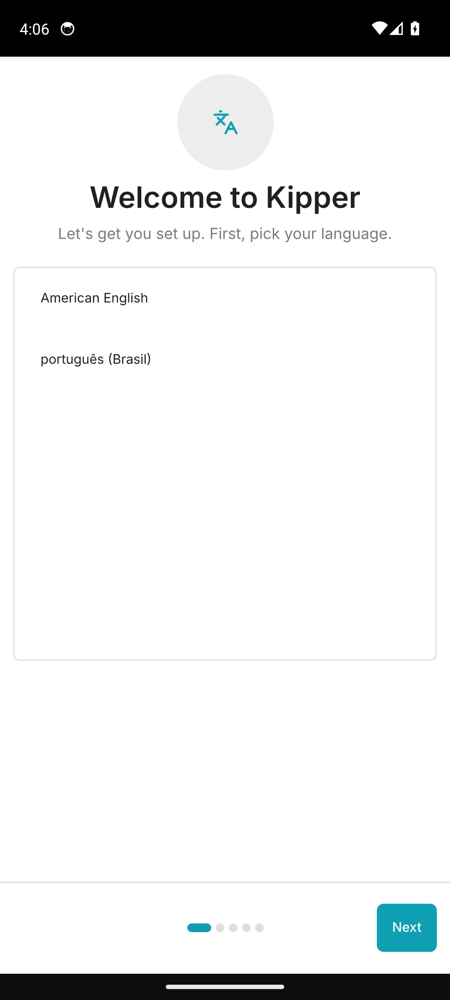
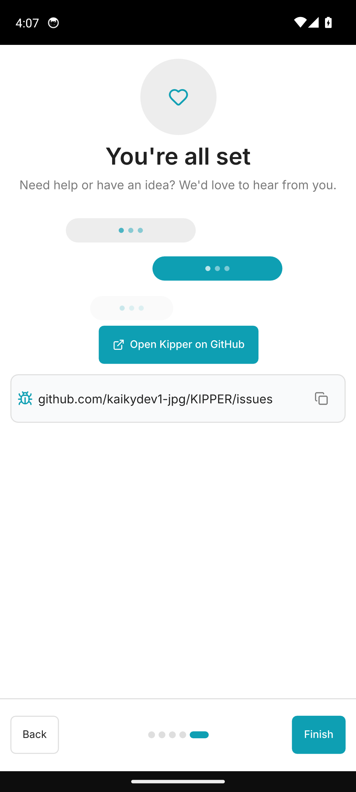

# Kipper no celular (Android virtual)

Geração: 44006483930 · placa: angle_indirect · roteiro: `start; wait 35; print 0-boasvindas; tap 86 366; wait 3; tap 371 859; wait 3; tap 371 859; wait 3; tap 371 859; wait 3; tap 371 859; wait 3; tap 371 859; wait 8; print 1-inicio; share exemplo-empe.mp4; wait 12; print 2-compartilhado; wait 8; print 3-depois`

