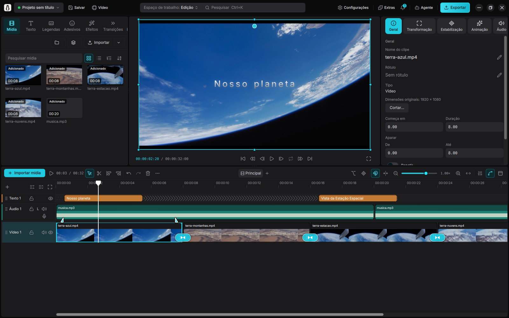

<p align="center">
  
</p>

<h1 align="center">Kipper</h1>

<p align="center">
  <strong>Editor de vídeo gratuito, do primeiro corte ao filme inteiro.</strong><br>
  Sem marca d'água, sem conta, sem assinatura. Windows e Linux.
</p>

<p align="center">
  
</p>

## Instalar

**Linux, pelo terminal** (descobre o sistema, baixa o arquivo certo, confere o SHA-256 e instala):

```bash
curl -fsSL https://github.com/kaikydev1-jpg/KIPPER/releases/latest/download/instalar.sh | bash
```

Ou baixe o arquivo do seu sistema na [página de versões](https://github.com/kaikydev1-jpg/KIPPER/releases):

| Sistema | Arquivo |
|---|---|
| Windows 10 e 11 | `Kipper-Windows.exe` (instala só para o seu usuário, sem pedir administrador) |
| Fedora | `Kipper-Fedora.rpm` · `sudo dnf install ./Kipper-Fedora.rpm` |
| Fedora Atomic (Silverblue, Kinoite…) | `Kipper-Flatpak.flatpak` · `flatpak install --user ./Kipper-Flatpak.flatpak` |
| Matsu OS | `Kipper-Matsu-OS.flatpak` (já abre com o visual do Matsu OS) |
| Ubuntu, Debian, Mint, Pop!_OS, Zorin | `Kipper-Ubuntu-Debian.deb` · `sudo apt install ./Kipper-Ubuntu-Debian.deb` |
| Outras distros | `Kipper-Linux.AppImage` (sem instalar) ou o Flatpak |

As somas SHA-256 ficam em `SHA256SUMS.txt`, junto dos arquivos.

## O que ele faz

- **Vídeo em pé do jeito certo:** projeto em 9:16 para Reels, TikTok e Shorts deixa a prévia em pé ao lado da linha do tempo, como no CapCut.
- **Para quem começa e para quem já edita:** cortar, legendar e publicar em poucos cliques; espaços de trabalho de cor, áudio, quadros-chave e máscaras para projetos grandes.
- Legendas automáticas feitas no próprio computador, correção de cor (rodas, curvas, HSL, LUTs), quadros-chave com curvas, máscaras com rastreamento, mais de 150 transições, efeitos, áudio com limpeza de voz e exportação até 4K.
- Barra de título integrada no Windows e no Linux, seguindo os botões do sistema (Windows 11, GNOME, KDE, Mac e as bolinhas do Matsu OS).
- Em português do Brasil e em inglês.
- **Sem telemetria.** A única coisa que o Kipper lê da internet por conta própria é a lista pública de versões do GitHub, uma vez por dia, e dá para desligar.

## Compilar

O Kipper usa Qt 6.10+, FFmpeg 7.1, Skia e CMake (detalhes em [docs/BUILDING.md](docs/BUILDING.md), herdado do Drift).

```bash
third_party/build-skia.sh linux-x64
cmake -B build -G Ninja -DCMAKE_BUILD_TYPE=RelWithDebInfo -DCMAKE_PREFIX_PATH="/caminho/do/Qt/6.10.3/gcc_64"
cmake --build build
./build/drift
```

O executável compilado se chama `drift` (nome interno do código, para facilitar trazer as correções do Drift); nos instaladores ele aparece como **Kipper**. Os instaladores são gerados pelo fluxo **Instaladores do Kipper** no GitHub Actions (veja [docs/KIPPER.md](docs/KIPPER.md)).

## Créditos e licença

O Kipper é software livre sob a licença [GPL-3.0-or-later](LICENSE).

- Baseado no **[Drift](https://github.com/CutWire-Studios/Drift)**, da CutWire Studios (GPLv3), que faz o trabalho pesado: motor de vídeo, efeitos, linha do tempo e exportação.
- Ideias de design do **[Concat](https://github.com/jub0t/Concat)**.
- Barra de título integrada com a **[QWindowKit](https://github.com/stdware/qwindowkit)** (Apache-2.0).
- Bibliotecas de terceiros e suas licenças: [THIRD_PARTY_NOTICES](resources/licenses) e o histórico do Drift neste repositório.
